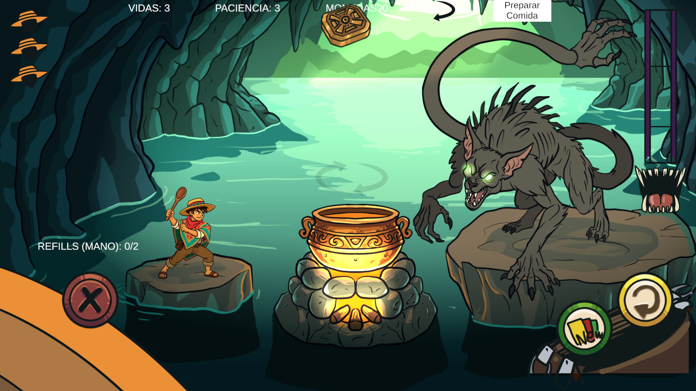
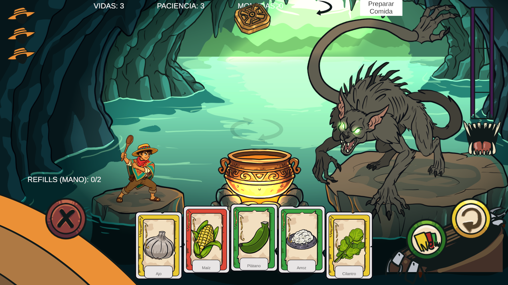

# Card Prefab Root Anchor — Empirical Check

**Date**: 2026-10-18
**Scope**: `Assets/Prefabs/Cards/Card.prefab` only
**Unity**: 6000.3.10f1 — instance `GameJamUni2@9eee0fc1` (MCP bridge live, Editor focused)
**Scene**: `Assets/Scenes/Prototype.unity`

## Verdict

The uncommitted anchor change was **NOT harmless**: it pushed the entire 5-card hand
**~540 px below the canvas bottom edge (fully off-screen)**. It has been **reverted** —
card root RectTransform restored to the committed HEAD state. The two child re-anchors
were left untouched.

## Why the change broke it (root cause)

`CardView` never touches the anchors, but it **owns `anchoredPosition` at runtime**:
`MoveTo(...)` writes the parabola slot from `CardVisualConfig.parabolaStart/End`
(y = −390) every frame.

Anchored position is measured **from the anchor point**, so the same `y = −390`
lands in a different place depending on the anchor:

| Card root anchors | Parent reference point | Runtime local Y | World Y |
|---|---|---|---|
| `(0.5, 0.5)` @ `(0, 0)` (HEAD) | parent centre | `0 + (−390)` = −390 | **540 − 390 = 150** ✅ on-screen |
| `(0.5, 0)` @ `(0, 540)` (dirty) | parent bottom edge | `−540 + (−390)` = −930 | **540 − 930 = −390** ❌ 390 px below the bottom edge |

The parent is the full-screen `Canvas/Hand` RectTransform (stretch, 1920×1080, world
centre `(960, 540)`); the canvas therefore spans world Y `0 … 1080`.

The prefab's authored default `(0, 540)` *looks* like a compensating correction, and it
would be for the authored position — bottom-anchored `+540` equals centre-anchored `0`
when the parent is exactly 1080 tall. But the authored value is **dead data**: `CardView`
overwrites it on the first `DealIn`/`SetSlot`. So the compensation never applies and only
the −half-parent-height error survives.

The two child re-anchors (`Name` → `(0.5, 0)` @ y 21.32; `Image` → stretch,
`sizeDelta (−60, −80)`) **are** position-preserving and correct, because nothing rewrites
their `anchoredPosition` at runtime. They were deliberately left as-is.

## Empirical evidence

### Before (dirty anchor)

Live play-mode read (`Canvas/Hand` children, 5 cards, all `activeInHierarchy = true`):

```
Card(Clone) anchored=(-360.00, -390.00) anchorMin=(0.50, 0.00) world=(600.00,  -390.00)
Card(Clone) anchored=(-180.00, -367.50) anchorMin=(0.50, 0.00) world=(780.00,  -367.50)
Card(Clone) anchored=(   0.00, -360.00) anchorMin=(0.50, 0.00) world=(960.00,  -360.00)
Card(Clone) anchored=( 180.00, -367.50) anchorMin=(0.50, 0.00) world=(1140.00, -367.50)
Card(Clone) anchored=( 360.00, -390.00) anchorMin=(0.50, 0.00) world=(1320.00, -390.00)
```

World Y `−390 … −360` → **below** the canvas bottom edge (0). Screenshot shows the HUD
(`REFILLS (MANO): 0/2`) with **no cards rendered**.



### After (restored to HEAD: `anchorMin = anchorMax = (0.5, 0.5)`, `anchoredPosition = (0, 0)`)

```
Card(Clone) anchored=(-360.00, -390.00) anchorMin=(0.50, 0.50) world=(600.00,  150.00)
Card(Clone) anchored=(-180.00, -367.50) anchorMin=(0.50, 0.50) world=(780.00,  172.50)
Card(Clone) anchored=(   0.00, -360.00) anchorMin=(0.50, 0.50) world=(960.00,  180.00)
Card(Clone) anchored=( 180.00, -367.50) anchorMin=(0.50, 0.50) world=(1140.00, 172.50)
Card(Clone) anchored=( 360.00, -390.00) anchorMin=(0.50, 0.50) world=(1320.00, 150.00)
```

World Y `150 … 180` → on-screen. Screenshot shows the full 5-card fan
(Ajo, Maíz, Plátano, Arroz, Cilantro) with the flatter, bigger layout.



## What was changed

Exactly one edit, in `Assets/Prefabs/Cards/Card.prefab` (root `RectTransform`
`fileID: 7514559849567688103`, GameObject `4622126435625404413`):

```diff
   m_Father: {fileID: 0}
   m_LocalEulerAnglesHint: {x: 0, y: 0, z: 0}
-  m_AnchorMin: {x: 0.5, y: 0}
-  m_AnchorMax: {x: 0.5, y: 0}
-  m_AnchoredPosition: {x: 0, y: 540}
+  m_AnchorMin: {x: 0.5, y: 0.5}
+  m_AnchorMax: {x: 0.5, y: 0.5}
+  m_AnchoredPosition: {x: 0, y: 0}
   m_SizeDelta: {x: 140, y: 200}
   m_Pivot: {x: 0.5, y: 0.5}
```

Everything else in the prefab is untouched. Post-edit `git diff` on the prefab now shows
**only** the two position-preserving child re-anchors (`Name`, `Image`); the card root
block is byte-identical to HEAD. No scripts, scenes, or other prefabs were touched.

Live prefab asset verification after the edit:

```
PREFAB ROOT anchorMin=(0.50, 0.50) anchorMax=(0.50, 0.50) anchoredPos=(0.00, 0.00) sizeDelta=(140.00, 200.00)
  child BG     aMin=(0.00, 0.00) aMax=(1.00, 1.00) pos=(0.00, 0.00)   size=(-18.08, -25.82)
  child Image  aMin=(0.00, 0.00) aMax=(1.00, 1.00) pos=(0.00, 0.00)   size=(-60.00, -80.00)
  child Border aMin=(0.00, 0.00) aMax=(1.00, 1.00) pos=(0.00, 0.00)   size=(0.00, 0.00)
  child Icon   aMin=(0.50, 0.50) aMax=(0.50, 0.50) pos=(-0.34, 12.68) size=(105.93, 103.04)
  child Name   aMin=(0.50, 0.00) aMax=(0.50, 0.00) pos=(-0.29, 21.32) size=(74.25, 31.60)
```

## Console status

`read_console` (errors + warnings) before and after play: a single pre-existing,
unrelated entry — `Account API did not become accessible within 30 seconds…` (Unity AI
Assistant account/licensing backend). **No compile errors, no runtime errors, no TMP
messages.** `LiberationSans SDF - Fallback.asset` was **not** re-dirtied
(`git status` shows no change to it) — nothing to revert.

## Operational note

Entering play mode triggered a domain reload that dropped the MCP bridge
(`mcpforunity://instances` → 0). Re-focusing the Unity Editor window
(`editor-28772-ttvyca`, pid 28772) restored it within ~10 s. Budget for this on any
play-mode round-trip: **re-focus Unity, then poll instances** before issuing tool calls.

## Residual risk (unverified)

The off-screen/on-screen finding is verified **at 16:9 / 1920×1080** (Game view and
`Screen` both 1920×1080, `CanvasScaler` ScaleWithScreenSize, match 0.5). At a different
aspect ratio the `Canvas/Hand` rect height deviates from 1080, so *any* non-centre anchor
on the card root would introduce a proportional offset. Restoring `(0.5, 0.5)` removes
that class of bug; not re-tested at other aspect ratios.
